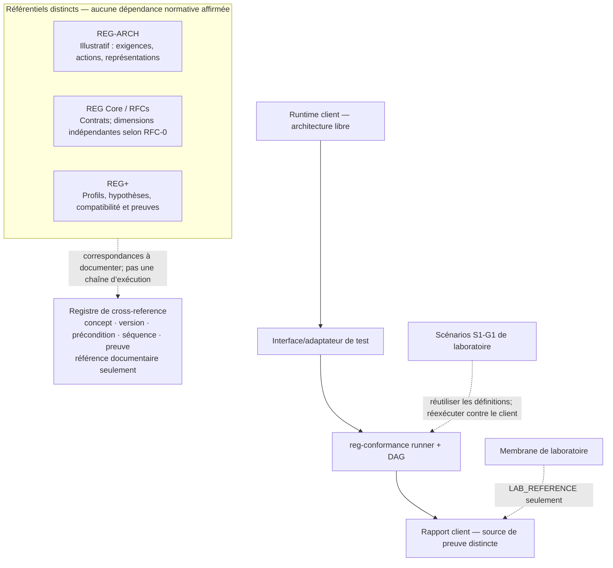
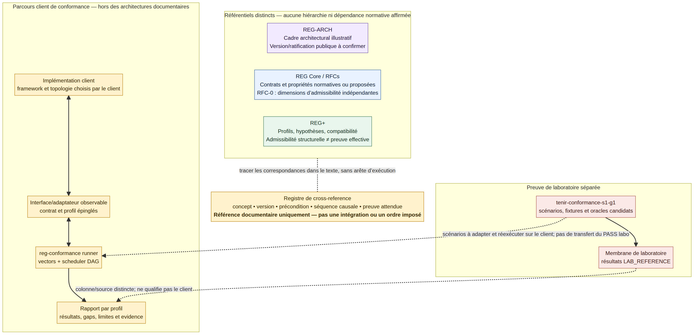
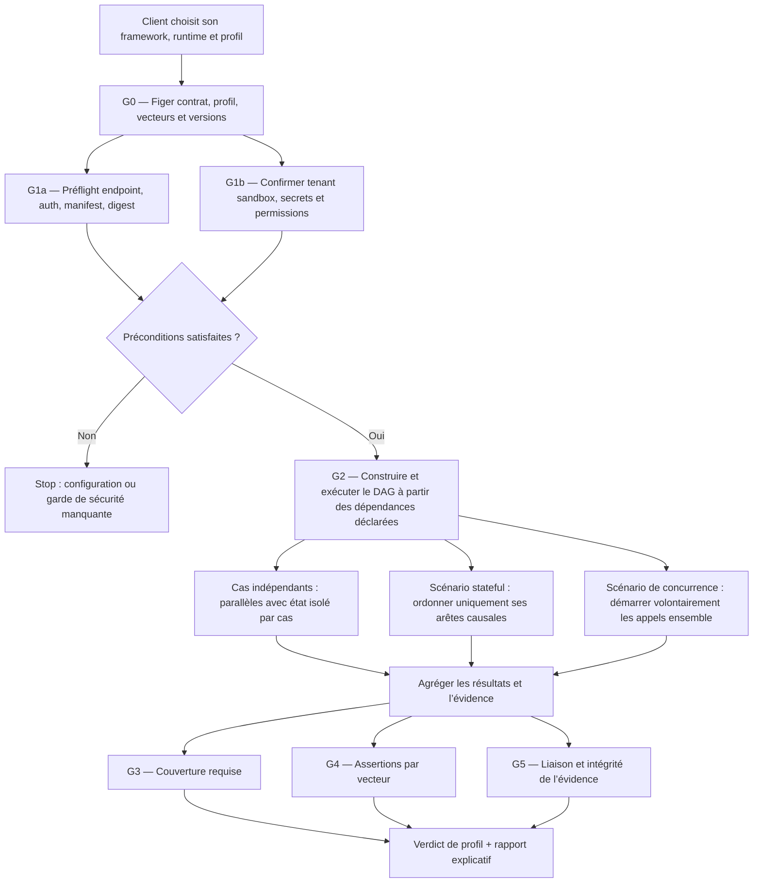
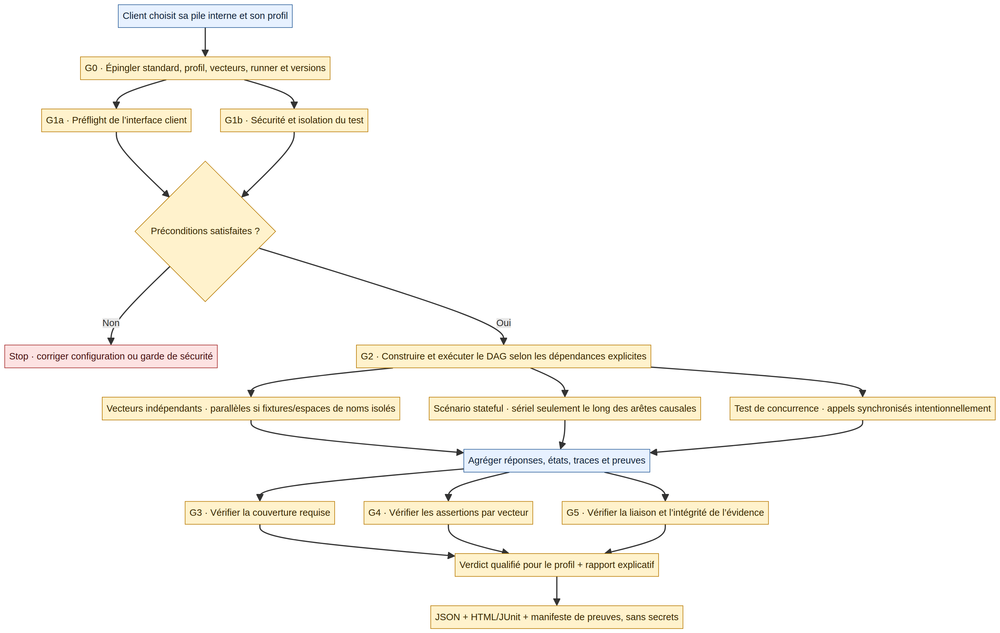

# Modèle d’exécution de la conformance client REG

**Statut : proposition documentaire, non normative, à faire approuver avant de figer le contrat machine.** Cette note décrit un orchestrateur possible pour qu’une implémentation client, quelle que soit sa pile interne, exécute les vecteurs REG sélectionnés par son profil et reçoive un rapport borné.

## Règle de séquencement à retenir

Le standard ne prescrit **pas** une pipeline séquentielle pour évaluer Standing, Structure et Commit. RFC-0 §3 les définit comme des dimensions indépendantes portant sur une même tentative. Une implémentation peut les évaluer en série ou en parallèle; le standard exige une composition déterministe des dispositions, avec la règle de restriction la plus forte. Voir [RFC-0, §§3–4](../reg-standards-baseline/rfc/rfc-0.md).

Il faut distinguer cette liberté normative de deux autres ordres :

1. **L’ordre de contrôle de l’orchestrateur.** Le contrat, le profil et les versions doivent être fixés avant le préflight; les résultats sont nécessaires avant le rapport final. C’est un ordre du produit de test, pas une contrainte sur l’architecture client.
2. **L’ordre causal d’un scénario.** Un scénario qui change l’état, avance une horloge ou consomme un permit contient des opérations ordonnées par son assertion. Seules ces arêtes `happens-before` sont séquentielles.

Les vecteurs entre scénarios sont parallélisables par défaut **uniquement** si le runner leur attribue des fixtures/ressources isolées. Les tests de concurrence sont, eux, parallèles intentionnellement. L’ordre d’une liste YAML ou d’un dictionnaire Python ne constitue jamais une dépendance normative.

## Couches et références — sans fusion normative

| Artefact/couche | Rôle utilisé par ce modèle | Ne signifie pas |
|---|---|---|
| **REG-ARCH** | Cadre architectural illustratif pour relier exigences, actions et représentations/preuves, et rendre visibles objets, transitions, gates et bindings. La page publique classe l’architecture comme illustrative; elle cite REG-ARCH v0.4 mais indique que la version publique faisant autorité et la ratification ne sont pas vérifiées. | Ni schéma normatif, ni dépendance d’exécution, ni preuve d’implémentation. |
| **REG Core / RFC-0…RFC-7** | Contrats et propriétés normatives/proposées qui définissent ce qu’un système doit préserver à la frontière d’exécution. Pour l’ordre des dimensions, RFC-0 §3 fait autorité dans cette série. | Ne prescrit pas le framework, le langage, la base de données ou une topologie interne unique. |
| **REG+** | Profils, hypothèses, règles de compatibilité et vérification technique des preuves. Le profil sélectionné décrit la configuration à examiner et les exigences de preuve; l’admissibilité structurelle n’est pas une garantie effective. | Ni implémentation client, ni certification, ni preuve que les effets réels se sont produits. |
| **`reg-conformance`** | Catalogue versionné de vecteurs, interface(s) et rapport du runner. Le client peut garder sa pile interne et fournir une surface observable par HTTP ou un adapter convenu. | Le mode `native` du runner n’est pas le runtime du client; un gap n’est pas un PASS. |
| **`tenir-conformance-s1-g1`** | Bibliothèque de définitions opérationnelles, fixtures/oracles de laboratoire et tests pour certaines transitions RFC-4, notamment S1–S6, S8, T7/T8 et S12. | Ni suite universelle complète ni preuve de conformance d’un endpoint client. Ses statuts restent ceux du harness/membrane de laboratoire. |

Ces artefacts restent des références distinctes. Le crosswalk est une table de traçabilité, pas un graphe de dépendance exécutable. REG-ARCH n’est pas « au-dessus » de REG Core au sens normatif. REG+ ne remplace pas les RFC Core; le harness S1-G1 ne modifie ni l’un ni l’autre.

### Crosswalk conceptuel

| Question de traçabilité | Source à consulter | Consommation par le runner client |
|---|---|---|
| Quelle exigence, quelle action et quelle preuve sont reliées? | REG-ARCH (illustratif) | Aide à annoter le rapport et les hypothèses; ne change pas l’oracle normatif. |
| Quelle propriété et quel verdict sont exigés? | Version précise de REG Core/RFC et vecteur accepté | Assertions et résultats du profil. |
| Dans quelle configuration la propriété est-elle revendiquée? | REG+ : profil, hypothèses, compatibilité et manifeste | Préflight et sélection des vecteurs/preuves applicables. |
| Quel scénario d’incertitude ou de reprise exerce la transition? | `tenir-conformance-s1-g1` | Définition/scénario adapté au client via l’interface de conformance; résultat de laboratoire rapporté séparément. |

Source éditable : [diagramme de crosswalk](REG_Layered_Crosswalk.mmd). Rendu PNG : [REG_Layered_Crosswalk.png](diagrams/REG_Layered_Crosswalk.png).

Les cases REG-ARCH, REG Core et REG+ n’ont volontairement aucune arête directe entre elles.

## Cross-reference de l’ordre illustré par REG-ARCH

La page REG-ARCH décrit cinq niveaux, du contexte métier/réglementaire et de la médiation vers REG Core/REG+ puis le runtime. Elle décrit aussi `Evaluate()` comme pur, `Commit()` comme mutateur conditionnel et `Record()` comme production de preuve; `Assure()` observe des hypothèses et fournit des signaux attestés. La page publique qualifie le dessin d’illustratif et précise qu’il n’est ni le schéma normatif, ni le code, ni une preuve d’implémentation. Le lien de navigation de REG-ARCH vers « REG+ & RFCs » ne crée donc pas une dépendance normative ou une intégration automatique du runner. [REG-ARCH](https://tenirlabs.cc/en/architecture/) [fiche et statut REG-ARCH](https://tenirlabs.cc/en/portfolio/reg-arch/)

Pour le futur crosswalk, cette chaîne peut aider à nommer des préconditions et observations, mais l’ordonnanceur ne doit pas la transformer en ordre obligatoire pour tous les tests. Pour un scénario donné, une arête comme `decision validée → tentative de commit → enregistrement du résultat` n’est ajoutée que si la version du contrat testée l’exige et si les observations du client la rendent mesurable. L’évaluation de Standing, Structure et Commit reste libre d’être parallèle. Les signaux `Assure()` ne sont pas automatiquement disponibles ni vrais : le profil et l’évidence doivent préciser source, autorité, fraîcheur et binding.

## Flux et scheduling proposés

Le diagramme représente les contrôles préalables nécessaires, puis un ordonnanceur de scénarios plutôt qu’une liste linéaire de vecteurs. Après fixation du contrat (G0), le contrôle de configuration (G1a) et le contrôle de sécurité (G1b) peuvent être exécutés en parallèle; tous deux doivent passer avant un test avec secrets ou mutations. Après l’exécution, couverture, assertions et qualité de l’évidence sont calculées comme des dimensions distinctes puis agrégées.

Source éditable : [REG_Client_Conformance_Flow_Gates.mmd](diagrams/REG_Client_Conformance_Flow_Gates.mmd).

G0–G5 sont des **gates du produit d’essai proposés ici**, pas des IDs de gate normatifs du standard. G2 est la gate de scheduling/exécution. G3–G5 peuvent être calculés en parallèle une fois le jeu complet des résultats rassemblé; le verdict final attend leur agrégation.

## Hypothèses explicites

1. **Neutralité de pile.** Le client choisit langage, framework, stockage et topologie. Pour participer à la suite actuelle, il doit exposer l’interface HTTP contractuelle ou un adapter traduit vers cette interface. Le runner n’offre pas encore un plugin universel pour toute technologie.
2. **Profil déclaré.** Le client et l’évaluateur fixent ensemble une version de REG Core, une version REG+, un profil, un catalogue de vecteurs, un périmètre et un modèle de faute. REG+ peut rejeter une configuration structurellement inadmissible; cela ne vaut pas une preuve opérationnelle.
3. **Environnement non productif.** Les vecteurs utilisent un tenant de test, un effet simulé ou un sink explicitement non productif. Le runner ne doit pas déclencher de paiement, d’écriture ou d’effet externe réel.
4. **Isolation inter-scenarios.** Chaque scénario reçoit un espace de noms distinct (Realm/LEI/nonce/permit/evidence chain) ou un reset prouvé. En l’absence de cette propriété, l’ordonnanceur sérialise les cas qui partagent un état mutable.
5. **Horloge contrôlée.** Les cas de TTL/τ_K utilisent une horloge de test explicite ou une interface équivalente; l’heure murale ne doit pas rendre les mêmes vecteurs non reproductibles.
6. **Ordre intra-scenario.** Les seules séquences requises viennent des préconditions, transitions et assertions écrites dans le scénario. Un scénario doit nommer les états initiaux et finaux, les mutations et les événements observables.
7. **Concurrence bornée.** Un résultat concurrent n’est valable que pour le nombre de threads/processus, l’interleaving, l’hôte et les répétitions enregistrés. Les tests de laboratoire actuels ne prouvent pas toute concurrence asynchrone ni le multi-host.
8. **Séparation des niveaux de preuve.** `LAB_PROBE_PASS_ONLY`, adapter-tested, native et evidence independent restent distincts; aucun résultat de membrane de laboratoire n’est promu automatiquement en résultat natif client.
9. **Provenance.** Le rapport épingle les commits des vecteurs, du runner, du harness réutilisé, du sujet client et l’image/dépendances exécutées. Une somme SHA-256 prouve l’intégrité du fichier reçu, pas la vérité de son contenu.
10. **Aucune certification implicite.** Le rapport décrit le périmètre, vecteurs, états et limites. Un `PASS_FOR_PROFILE` éventuel est une conclusion bornée au profil et à l’environnement testés.

## Graphe de dépendances observé dans le harness S1-G1

Le dépôt S1-G1 ne décrit pas une exécution obligatoire `S1 → S2 → S3 → S4 → S5 → S6`. Ses documents spécifient des sous-cas et dépendances ciblées. Les exécuter tous en chaîne imposerait un état partagé inutile et masquerait les préconditions propres à chaque test.

| Scénario | Ordre nécessaire à l’intérieur du cas | Dépendance entre cas | Planification par défaut proposée |
|---|---|---|---|
| S1 — evidence lost after commit | Admission/effet ou perte de requête/réponse → preuve absente → tentative de retry bloquée; chaque S1a/b/c est un sous-cas distinct. | T7/T8 de réconciliation sont explicitement séparés du test S1. | Parallèle avec d’autres cas si Realm/LEI et sinks sont isolés. |
| S2 — qualification timeout | Admission/consommation → attendre sans preuve → avancer l’horloge au-delà de τ_K → vérifier UNKNOWN/HOLD → retry bloqué. | La définition déclare une dépendance à l’état de verrou non résolu de S1; un setup équivalent peut être créé directement dans son propre fixture. | Ordonné à l’intérieur; pas besoin de s’exécuter après le run S1 si le fixture reproduit l’état initial. |
| S3 — duplicate request | A1 non résolue puis soumission A2 avec même LEI; S3a prévoit aussi une variante « concurrente ou ultérieure ». | Dépend de l’invariant de verrou LEI non résolu, décrit via S1; T7/T8 sont des conditions de retry distinctes. | Serial pour la variante ultérieure; concurrence synchronisée pour la variante racing, avec label différent. |
| S4 — stale receipt | A1 en attente → fenêtre fermée/TTL dépassé → présenter le reçu périmé et vérifier rejet sans mutation. | S4 et S6 sont deux interfaces différentes : livraison d’un reçu tardif vs observation via reconciliation. Ne pas réutiliser le reçu de S4 pour faire passer S6. | Chaque sous-cas peut démarrer depuis un fixture dédié; ordre interne strict. |
| S5 — contradictory evidence | Préparer l’état UNKNOWN ou terminal → envoyer un batch complet et lié → évaluer atomiquement → vérifier escalade/quarantaine et zéro nouvel effet. | Pas de dépendance globale à S1–S4 si le pré-état est construit dans le fixture. | Scénarios indépendants parallélisables sur fixtures isolées; évaluation du batch atomique. |
| S6 — successful reconciliation | Créer/charger UNKNOWN → soumettre la preuve de réconciliation → vérifier l’état de sortie; aucune mutation de permit/effet pendant reconciliation. | Peut consommer un état UNKNOWN produit par S1/S2/S4, mais la suite de tests peut aussi le construire localement. | Ordonné à l’intérieur; ne pas exécuter en partageant un état avec un autre scénario sans edge explicite. |
| S8 — concurrent admission | Barrière de départ pour appels simultanés, même LEI pour contention ou LEI distincts pour contrôle; assertions sur les courses bornées. | Aucun ordre global avant/après les autres tests; le cas a besoin de son propre état partagé sous contention. | Parallèle intentionnel à l’intérieur du cas; limites du résultat restent celles du processus et des interleavings testés. |
| S12 — cross-realm | Comparer des verdicts sous politiques Realm distinctes pour le même identifiant/couple transition-payload. | Dépend du chargement des deux politiques/versionnements, pas de l’exécution préalable de S1–S6. | Deux mondes isolés; l’ordre interne n’est pas imposé, mais comparer les deux résultats est nécessaire. |

Ces lignes reprennent le statut et les préconditions déclarés dans le harness. Elles ne déclarent pas encore que chaque scénario constitue un vecteur normatif REG Core accepté.

## Données de scheduling à figer avant l’action GitHub

`vectors/CONTRIBUTING.md` décrit `dependencies` comme champ optionnel, mais le `vectors/schema.json` actuel ne le permet pas et fixe `additionalProperties: false`. Cette incohérence doit être résolue avant de prétendre que l’ordonnancement est piloté par les métadonnées.

Proposition **à ratifier**, pas schéma accepté : chaque scénario publierait au minimum `execution_mode` (`independent`, `ordered`, `concurrent`), `depends_on`, `state_scope`, `setup`, `cleanup`, et le nom des clés de contention. Si le schéma ne peut pas exprimer un graphe `happens-before` lisible, garder ces dépendances dans un fichier de scénarios séparé plutôt qu’inférer l’ordre à partir des noms S1/S2 ou des chemins de fichiers.

Avant de geler l’action client, créer une matrice de versions compatible : le tree contient plusieurs étiquettes entre `spec.md` v0.3.1, `runner.py` v0.3.2 et la release/site Conformance v0.6.1. Elles ne doivent pas être compressées en une version unique sans décision éditoriale.

## Réutilisation bornée du dépôt S1-G1

Réutiliser ses définitions d’opérations, préconditions, sous-cas, assertions, horloge déterministe, traces JSONL et snapshots comme **scénarios d’interopérabilité candidate**. L’exécution client doit passer par un nouveau driver/adapter qui envoie les opérations au système sous test et collecte ses réponses/états. La membrane de laboratoire peut rester oracle de référence, dans une colonne séparée.

Le README/STATUS S1-G1 déclare des PASS empiriques pour les interleavings séquentiels testés, mais exclut la concurrence générale, la validation cryptographique de production et la certification d’une gateway. S8, au contraire, est explicitement une expérience bornée à deux threads dans un processus. L’action doit conserver ces différences dans le rapport et ne pas aplatir les preuves dans un seul badge.

## Liens de référence

- [RFC-0, Constitution et indépendance topologique](../reg-standards-baseline/rfc/rfc-0.md)
- [Métadonnées de vecteur — schéma](../vectors/schema.json) et [guide d’ajout](../vectors/CONTRIBUTING.md)
- [REG+ / contrats et fondations](https://tenirlabs.cc/portfolio/technical/)
- [REG-ARCH, page publique](https://tenirlabs.cc/en/portfolio/reg-arch/) et [architecture illustrative](https://tenirlabs.cc/en/architecture/)
- [`tenir-conformance-s1-g1` — STATUS](https://github.com/skiredj-prog/tenir-conformance-s1-g1/blob/main/STATUS.md), [S1](https://github.com/skiredj-prog/tenir-conformance-s1-g1/blob/main/G0_S1_Evidence_Lost_After_Commit.md), [S2](https://github.com/skiredj-prog/tenir-conformance-s1-g1/blob/main/G0_S2_Qualification_Timeout.md), [S3](https://github.com/skiredj-prog/tenir-conformance-s1-g1/blob/main/G0_S3_Duplicate_Request.md), [S4](https://github.com/skiredj-prog/tenir-conformance-s1-g1/blob/main/G0_S4_Stale_Receipt.md), [S8](https://github.com/skiredj-prog/tenir-conformance-s1-g1/blob/main/scenarios/G0_S8_CONCURRENT_ADMISSION.md)
